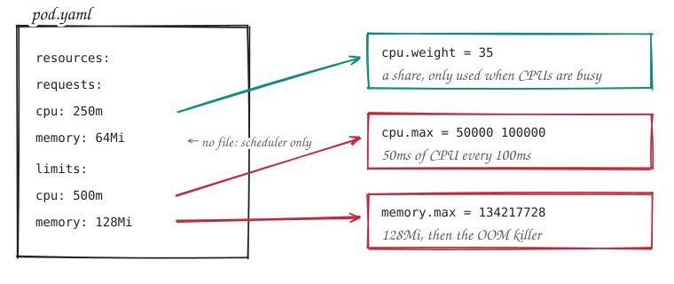

<div align="center">

# Kubernetes resources, under the hood

### From YAML to cgroups

A hands-on lab that shows what **requests, limits, QoS classes, priority classes and quotas** actually do inside the Linux kernel, on your own laptop.

[](https://github.com/NITHIN-JOHN-GEORGE/kubernetes-resources-under-the-hood/actions/workflows/lab.yml)


**[📖 Read the illustrated walkthrough](https://nithin-john-george.github.io/blog/cgroups-deep-dive-kubernetes/)** &nbsp;·&nbsp; [Quick start](#quick-start) &nbsp;·&nbsp; [Modules](#modules) &nbsp;·&nbsp; [Setup](#setup)

</div>

<br>

Every `resources:` block you write ends up as a few numbers in files under `/sys/fs/cgroup` on a node. Kubernetes writes the numbers; the **Linux kernel** enforces them. This lab creates a local cluster, runs pods with specific settings, and **reads the real kernel files**, so you can watch CPU throttling, OOM kills, evictions and QoS decisions happen instead of taking them on trust.

<p align="center">
  <picture>
    <source media="(prefers-color-scheme: dark)" srcset="docs/img/big-picture-dark.svg">
    
  </picture>
</p>

## Quick start

```bash
git clone https://github.com/NITHIN-JOHN-GEORGE/kubernetes-resources-under-the-hood.git
cd kubernetes-resources-under-the-hood
make cluster              # 2-node kind cluster inside Docker (about a minute)
make 01-cgroups-by-hand   # start here, then go in order
```

Each module prints what it does, reads the kernel files, and ends with checks:

```text
  pod            periods          throttled      CPU used (millicores)
  cpu-limited    250              249            200
  cpu-unlimited  -                0              several thousand
PASS cpu-limited was throttled in 249 periods
PASS cpu-unlimited was never throttled
```

Before any measurement, a module tells you **what it started and why**: each pod carries a one-line `what` note, printed with its requests and limits.

```text
What's running:
  cpu-limited: 4 busy loops that each want a whole CPU, squeezed into a 200m limit.
    requests {"cpu":"100m","memory":"16Mi"}   limits {"cpu":"200m","memory":"32Mi"}
```

> [!TIP]
> Learn by following a module's README step by step; use `make` to check your results or rerun quickly. Every module cleans up its own pods, even if a check fails or you press Ctrl-C. Run with `KEEP=1` to keep them and poke around.

## Modules

<p align="center">
  <picture>
    <source media="(prefers-color-scheme: dark)" srcset="docs/img/yaml-files-dark.svg">
    
  </picture>
</p>

#### 🧱 Part 1 · Cgroups from scratch

| | Module | What you'll see |
|:-:|---|---|
| `00` | [**cgroups v2 on a node**](modules/00-setup) | The node's cgroup tree, and the box that holds every pod |
| `01` | [**Build a cgroup by hand**](modules/01-cgroups-by-hand) | `mkdir`, `cpu.max`, `cgroup.procs`: throttle a process and OOM-kill another, with no Kubernetes |
| `02` | [**Follow one pod down**](modules/02-follow-the-pod) | The same numbers at every layer: pod spec → runtime spec → systemd scope → cgroup files |
| `03` | [**Requests and limits**](modules/03-requests-and-limits) | Which line of YAML becomes which file |

#### ⚙️ Part 2 · CPU

| | Module | What you'll see |
|:-:|---|---|
| `04` | [**CPU weight**](modules/04-cpu-weight) | Contended CPU split by request, and the old vs new shares-to-weight formula |
| `05` | [**CPU throttling**](modules/05-cpu-throttling) | `nr_throttled` climbing under a limit while the node is idle |

#### 🧠 Part 3 · Memory

| | Module | What you'll see |
|:-:|---|---|
| `06` | [**Memory limits and OOM kills**](modules/06-memory-and-oom) | `OOMKilled`, exit code 137, `oom_kill` in `memory.events` |
| `07` | [**Memory, properly**](modules/07-memory-deep-dive) | File cache reclaimed without harm, anonymous memory OOM-killed, the working set |

#### 🖥️ Part 4 · The whole node

| | Module | What you'll see |
|:-:|---|---|
| `08` | [**QoS classes**](modules/08-qos-classes) | Guaranteed, Burstable, BestEffort slices and `oom_score_adj` |
| `09` | [**Node allocatable**](modules/09-node-allocatable) | Capacity vs allocatable, and a pod stuck on `Insufficient memory` |
| `10` | [**Node-pressure eviction**](modules/10-node-pressure-eviction) | The kubelet evicting a BestEffort hog under `MemoryPressure` ¹ |

#### 🔭 Part 5 · Observe, limit and adjust

| | Module | What you'll see |
|:-:|---|---|
| `11` | [**Pressure stall information**](modules/11-psi) | `cpu.pressure`, `memory.pressure`, `io.pressure` |
| `12` | [**PIDs and ephemeral storage**](modules/12-pids-and-ephemeral-storage) | `pids.max`, refused forks, eviction for disk use ¹ |
| `13` | [**In-place resize**](modules/13-in-place-resize) | `cpu.max` and `memory.max` changing with no restart (1.33+) |

#### 🛡️ Extras · Kubernetes policy (no cgroups involved)

| | Module | What you'll see |
|:-:|---|---|
| `14` | [**ResourceQuota**](modules/14-resourcequota) | `must specify` and `exceeded quota` at admission |
| `15` | [**LimitRange**](modules/15-limitrange) | Injected defaults landing in `cpu.max` and `memory.max` |
| `16` | [**Priority and preemption**](modules/16-priority-preemption) | A high-priority pod pushing a low-priority one off the node |

<sub>¹ Temporarily changes the worker's kubelet config and always restores it on exit.</sub>

**Each module folder has a hands-on README.** You type the commands yourself, one step at a time, and each step shows what you should see and explains it in plain English, including the Linux files involved (`cpu.max`, `memory.max`, `cpu.stat`, `memory.events`, `/proc/<pid>/oom_score_adj` and more). The `make` target runs the same steps in one go and checks the results.

## Watch it live

Open a second terminal while a module runs (with `KEEP=1`) and watch the kernel's numbers move once a second. Each line names the file it came from.

```bash
KEEP=1 make 05-cpu-throttling        # terminal 1
make watch POD=cpu-limited           # terminal 2
```

```text
watching cpu-limited   (Ctrl-C to stop)

CPU
  limit        200m                             (cpu.max: 20000 100000)
  used         200m in the last second          (cpu.stat: usage_usec)
  throttled    10 of 10 periods in the last second   (cpu.stat: nr_throttled / nr_periods)

MEMORY ...   PRESSURE ...
```

`./scripts/watch.sh --cgroup /sys/fs/cgroup/lab-cpu` watches any cgroup on the node, like the ones you build by hand in module 01.

## Incidents: debug it yourself

Once you've done the modules, try the [**incidents**](incidents): a broken pod, a ticket that sounds like a real page, and no instructions. You dig through the cgroup files yourself.

| # | Ticket |
|:-:|---|
| `1` | "Checkout is slow, but the CPU graph is under its limit" |
| `2` | "OOMKilled, but the dashboard never went above half" |
| `3` | "Pending for ages, the node's memory is almost empty" |

```bash
make incident-1                  # start it and read the ticket
make hint-1                      # stuck?
make answer-1 CAUSE=<answer>     # checks you, explains, shows the fix
```

## Setup

You need **Docker Desktop**, **kind** and **kubectl**. Give Docker at least **4 CPUs and 6 GB of memory** (Docker Desktop → Settings → Resources).

<details open>
<summary><b>macOS</b></summary>

```bash
brew install kind kubectl
git clone https://github.com/NITHIN-JOHN-GEORGE/kubernetes-resources-under-the-hood.git
cd kubernetes-resources-under-the-hood
make cluster
```

</details>

<details>
<summary><b>Windows (WSL2)</b></summary>

Run everything inside an Ubuntu WSL2 terminal. Docker Desktop must use the WSL2 backend with integration enabled for your distro.

1. Make sure WSL2 uses cgroups v2. Create or edit `%UserProfile%\.wslconfig`:

   ```ini
   [wsl2]
   kernelCommandLine = cgroup_no_v1=all
   ```

   Then run `wsl --shutdown` in PowerShell and restart Docker Desktop.

2. In the Ubuntu terminal:

   ```bash
   sudo apt-get update && sudo apt-get install -y make
   curl -Lo kind https://kind.sigs.k8s.io/dl/latest/kind-linux-amd64 && chmod +x kind && sudo mv kind /usr/local/bin/
   curl -LO "https://dl.k8s.io/release/$(curl -Ls https://dl.k8s.io/release/stable.txt)/bin/linux/amd64/kubectl" && chmod +x kubectl && sudo mv kubectl /usr/local/bin/
   git clone https://github.com/NITHIN-JOHN-GEORGE/kubernetes-resources-under-the-hood.git
   cd kubernetes-resources-under-the-hood
   make cluster
   ```

</details>

Then run `make 00-setup`. If it reports that the node isn't on cgroups v2, follow the hint it prints.

## Commands

| Command | What it does |
|---|---|
| `make help` | List every target |
| `make <module>` | Run one module, e.g. `make 06-memory-and-oom` |
| `make all` | Run every module in order |
| `KEEP=1 make <module>` | Keep the module's pods so you can explore |
| `make watch POD=<pod>` | Live view of a pod's cgroup files |
| `make incident-N` / `hint-N` / `answer-N CAUSE=...` | Debugging challenges; `make incident-clean` removes them |
| `make reset` | Keep the cluster; remove everything the lab created and undo any kubelet change |
| `make clean` | Delete the whole kind cluster (`make cluster` to start again) |

## How it reads kernel files

- **From inside a container:** with cgroups v2 each container sees its own cgroup at `/sys/fs/cgroup`, so `kubectl exec <pod> -- cat /sys/fs/cgroup/cpu.max` shows that container's limit.
- **From the node:** a kind node is a Docker container, so `docker exec under-the-hood-worker cat /sys/fs/cgroup/...` reads the pod and QoS slices directly. kind runs the kubelet with `cgroupRoot: /kubelet`, so the pod tree lives under `kubelet.slice/kubelet-kubepods.slice`.

## Further reading

- 📖 [Cgroups: A Deep Dive into Resource Management in Kubernetes](https://nithin-john-george.github.io/blog/cgroups-deep-dive-kubernetes/): the beginner-friendly, illustrated walkthrough of every module
- [Kubernetes docs: Resource Management for Pods and Containers](https://kubernetes.io/docs/concepts/configuration/manage-resources-containers/)
- [Linux kernel docs: Control Group v2](https://docs.kernel.org/admin-guide/cgroup-v2.html)

## License

[Apache 2.0](LICENSE)
