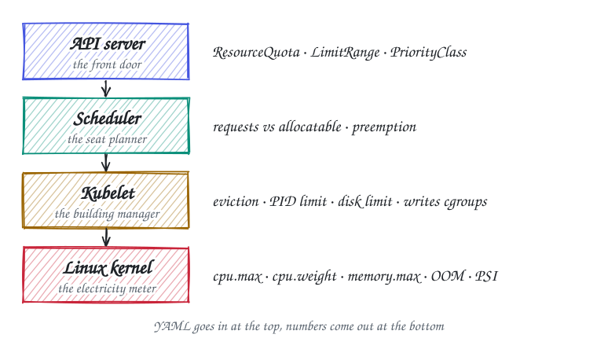

<div align="center">

# Kubernetes resources, under the hood

### From YAML to cgroups

The hands-on lab for **[Cgroups: A Deep Dive into Resource Management in Kubernetes](https://nithin-john-george.github.io/blog/cgroups-deep-dive-kubernetes/)**. One lab per chapter, run on your own laptop, reading the real kernel files.

[](https://github.com/NITHIN-JOHN-GEORGE/kubernetes-resources-under-the-hood/actions/workflows/lab.yml)


[Quick start](#quick-start) · [The labs](#the-labs) · [Incidents](#incidents) · [Commands](#commands) · [Setup](#setup)

</div>

<br>

Every `resources:` block you write ends up as a few numbers in files under `/sys/fs/cgroup` on a node. Kubernetes writes the numbers; the **Linux kernel** enforces them. Each lab here asks one question, has you predict the answer, then shows it to you in the real files with `kubectl`, `docker` and `cat`.

<p align="center">
  <picture>
    <source media="(prefers-color-scheme: dark)" srcset="docs/img/big-picture-dark.svg">
    
  </picture>
</p>

## Quick start

```bash
git clone https://github.com/NITHIN-JOHN-GEORGE/kubernetes-resources-under-the-hood.git
cd kubernetes-resources-under-the-hood
make check-setup                     # is Docker ready?
```

Then open **[labs/01-processes-and-threads](labs/01-processes-and-threads/)** and follow its README. Labs 01–07 need only Docker. From lab 08 on you need the cluster:

```bash
make cluster                         # 2-node kind cluster + the lab-tools image (about 2 minutes)
```

Every lab works the same way:

```bash
kubectl apply -f labs/14-limits-and-throttling/          # set it up (the README says so)
kubectl exec cpu-limited -- cat /sys/fs/cgroup/cpu.stat  # follow the steps by hand
make check LAB=14                                        # PASS/FAIL on what you just built (read-only)
kubectl delete -f labs/14-limits-and-throttling/         # done; on to lab 15
```

Nothing is deleted behind your back: pods stay until you delete them or run `make reset`.

## The labs

Each lab README follows the same rhythm: **question → predict → steps → what happened → one line to remember**, and links to its chapter of the blog.

#### Part 1 · Foundations (Docker only)

| Lab | You'll see |
|---|---|
| [01 · Processes and threads](labs/01-processes-and-threads/) | PIDs, threads in `/proc/<pid>/task`, `nproc` |
| [02 · Everything is a file](labs/02-everything-is-a-file/) | A 0-byte `/proc/meminfo` that still has content |
| [03 · /proc](labs/03-proc/) | `/proc/self/status`, `/proc/self/cgroup` |
| [04 · /sys and /sys/fs/cgroup](labs/04-sys-and-sys-fs-cgroup/) | `cgroup2`, mounted read-only |
| [05 · cpu.max and cpu.weight](labs/05-cpu-max-and-cpu-weight/) | `--cpus=0.5 --memory=128m` as `50000 100000` and `134217728` |
| [06 · CPU waits, memory kills](labs/06-cpu-waits-memory-kills/) | `nr_throttled` climbing vs exit code 137 |
| [07 · What a container is](labs/07-what-is-a-container/) | PID 1 inside, a long cgroup path outside |

#### Part 2 · By hand

| Lab | You'll see |
|---|---|
| [08 · Build a cgroup by hand](labs/08-build-a-cgroup-by-hand/) | `mkdir`, `echo`, `cgroup.procs`: throttle a loop, OOM-kill a process |

#### Part 3 · From YAML to kernel

| Lab | You'll see |
|---|---|
| [09 · The four checkpoints](labs/09-four-checkpoints/) | A pod stopped by the API server, one by the scheduler, one reaching the kernel |
| [10 · Follow one pod down](labs/10-follow-one-pod-down/) | The same numbers in the OCI spec, systemd and the cgroup files |
| [11 · The cgroup tree](labs/11-the-cgroup-tree/) | kubepods → QoS box → pod → container, and `oom_score_adj` |

#### Part 4 · CPU

| Lab | You'll see |
|---|---|
| [12 · How Linux shares a CPU](labs/12-how-linux-shares-a-cpu/) | An even split under contention |
| [13 · Requests become weights](labs/13-requests-become-weights/) | Container vs **pod** `cpu.weight`, and the 8× split |
| [14 · Limits and throttling](labs/14-limits-and-throttling/) | Throttled in nearly every 100 ms period |
| [15 · The outage](labs/15-the-outage/) | Bursts → throttling → probe timeouts → restarts |

#### Part 5 · Memory

| Lab | You'll see |
|---|---|
| [16 · Memory limits and OOM](labs/16-memory-limits-and-oom/) | `OOMKilled`, 137, `memory.events` |
| [17 · Not all memory is equal](labs/17-not-all-memory-is-equal/) | File cache reclaimed, anon killed, working set, `memory.peak` |
| [18 · Node pressure eviction](labs/18-node-pressure-eviction/) ¹ | Allocatable, `MemoryPressure`, the hog `Evicted` |

#### Part 6 · In production

| Lab | You'll see |
|---|---|
| [19 · Metrics and PSI](labs/19-metrics-and-psi/) | File → metric, `cpu.pressure`, `memory.pressure` |
| [20 · PIDs and disk](labs/20-pids-and-disk/) ² | `pids.max 64`, refused forks, an ephemeral-storage eviction |
| [21 · In-place resize](labs/21-in-place-resize/) | `cpu.max` 20000 → 50000, restarts=0 |

#### Extras · Kubernetes policy (no cgroups involved)

| Lab | You'll see |
|---|---|
| [E1 · ResourceQuota](labs/E1-resourcequota/) | `must specify`, `exceeded quota` |
| [E2 · LimitRange](labs/E2-limitrange/) | Injected defaults landing in `cpu.max` and `memory.max` |
| [E3 · Priority and preemption](labs/E3-priority-and-preemption/) | A high-priority pod pushing a low-priority one off the node |

<sub>¹ Needs `make cluster PROFILE=pressure`. ² Needs `make cluster PROFILE=pids`. A profile is a different kubelet setting, set when the cluster is created; nothing is edited live. Switch with `make clean && make cluster PROFILE=…`.</sub>

## Incidents

Once you've done the labs, try the [**incidents**](incidents/): something is broken, there's a ticket that reads like a real page, and no instructions.

| # | Ticket |
|:-:|---|
| 1 | "Checkout is slow, but the CPU graph is under its limit" |
| 3 | "OOMKilled, but the dashboard never went above half" |
| 4 | "Pending for ages, the node's memory is almost empty" |

```bash
make incident-1                  # start it and read the ticket
make hint-1                      # stuck?
make answer-1 CAUSE=<answer>     # checks you, explains, shows the fix
```

## Commands

`make` is only for the environment and for checks. The lessons themselves are plain `kubectl`, `docker` and `cat`.

| Command | What it does |
|---|---|
| `make check-setup` | Docker, tools, cluster, cgroups v2, and leftovers from earlier labs, with a fix for each ✗ |
| `make image` | Build the `lab-tools` image (`burn`, `alloc`, `cache`, `forkmany`, `serve`, `load`) |
| `make cluster` | Create the cluster and load `lab-tools` (`PROFILE=pressure` or `pids` for labs 18 and 20) |
| `make check LAB=14` | Read-only PASS/FAIL on what you built in a lab |
| `make test LAB=14` | Run a lab's README steps for you, end to end, and save the output to `expected.txt` |
| `make reset` | Remove everything the labs created; keep the cluster |
| `make clean` | Delete the cluster |

Two helpers you'll use in the labs:

- `./scripts/pod-cgroup.sh <pod>` prints a pod's cgroup folder on the node.
- `./scripts/watch.sh <pod>` is a live, once-a-second view of a pod's cgroup files, each line naming the file it came from.

## Setup

You need **Docker Desktop**, **kind** and **kubectl** (1.32 or newer). Give Docker at least **4 CPUs and 6 GB of memory** (Docker Desktop → Settings → Resources).

<details open>
<summary><b>macOS</b></summary>

```bash
brew install kind kubectl
```

</details>

<details>
<summary><b>Windows (WSL2)</b></summary>

Run everything inside an Ubuntu WSL2 terminal. Docker Desktop must use the WSL2 backend with integration enabled for your distro.

1. Make sure WSL2 uses cgroups v2. Create or edit `%UserProfile%\.wslconfig`:

   ```ini
   [wsl2]
   kernelCommandLine = cgroup_no_v1=all
   ```

   Then run `wsl --shutdown` in PowerShell and restart Docker Desktop.

2. In the Ubuntu terminal:

   ```bash
   sudo apt-get update && sudo apt-get install -y make
   curl -Lo kind https://kind.sigs.k8s.io/dl/latest/kind-linux-amd64 && chmod +x kind && sudo mv kind /usr/local/bin/
   curl -LO "https://dl.k8s.io/release/$(curl -Ls https://dl.k8s.io/release/stable.txt)/bin/linux/amd64/kubectl" && chmod +x kubectl && sudo mv kubectl /usr/local/bin/
   ```

</details>

Then run `make check-setup`. Every ✗ comes with the fix.

## Further reading

- [The blog post](https://nithin-john-george.github.io/blog/cgroups-deep-dive-kubernetes/), which this lab follows chapter by chapter
- [Linux kernel docs: Control Group v2](https://docs.kernel.org/admin-guide/cgroup-v2.html)
- [Kubernetes docs: Resource management for pods and containers](https://kubernetes.io/docs/concepts/configuration/manage-resources-containers/)

## License

[Apache 2.0](LICENSE)
